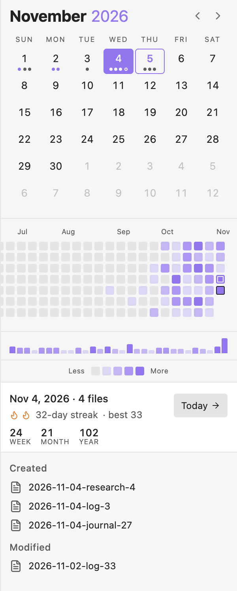
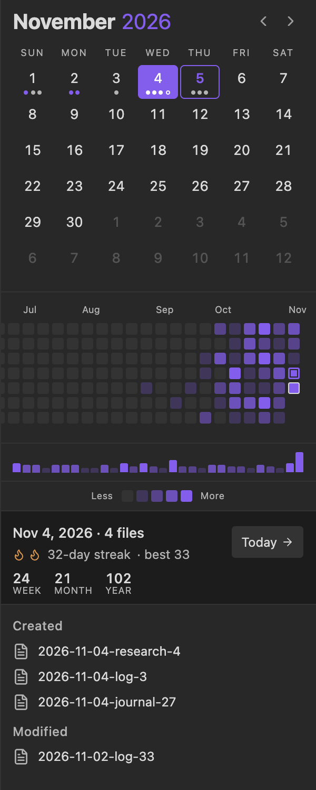
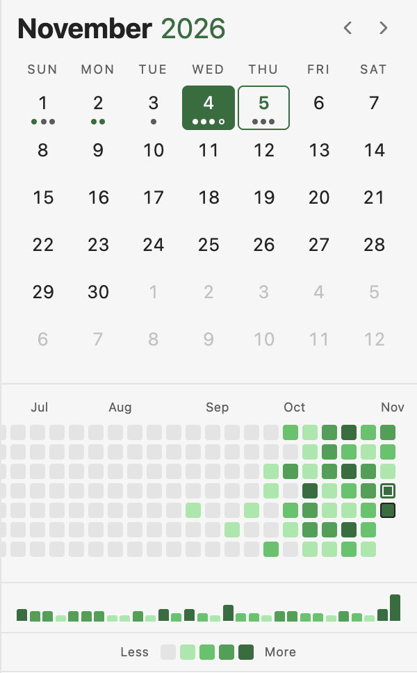
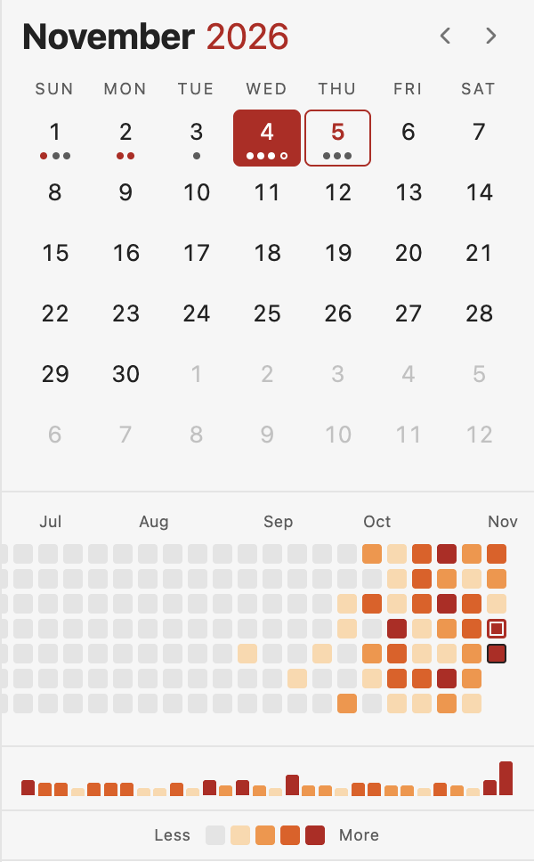
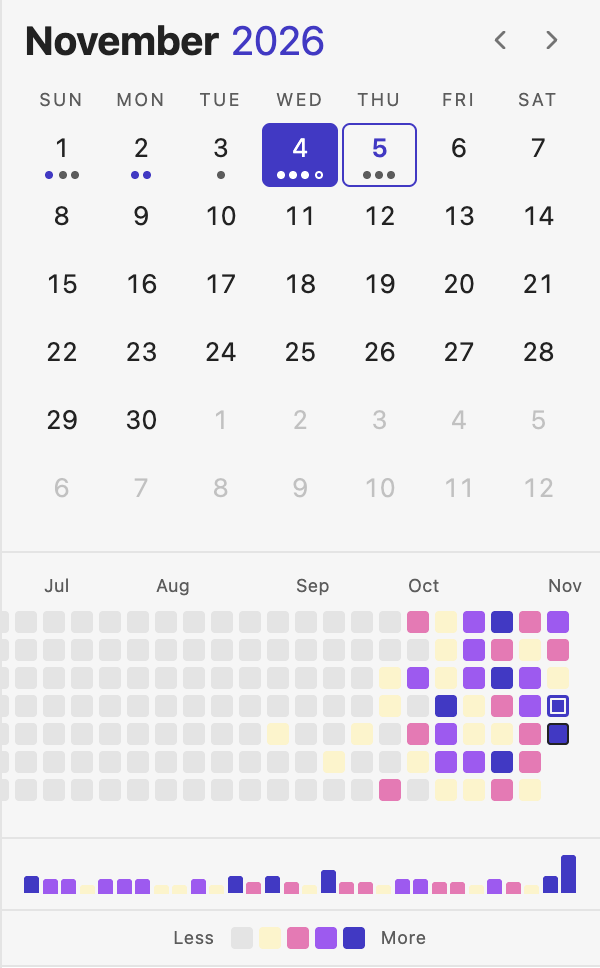
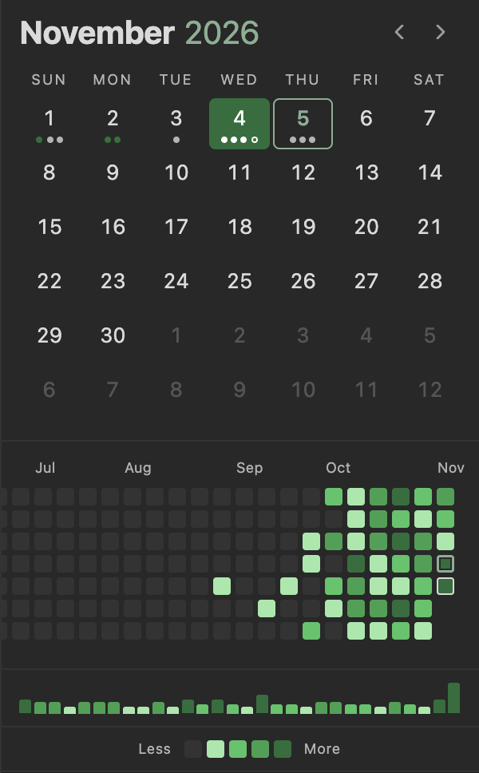
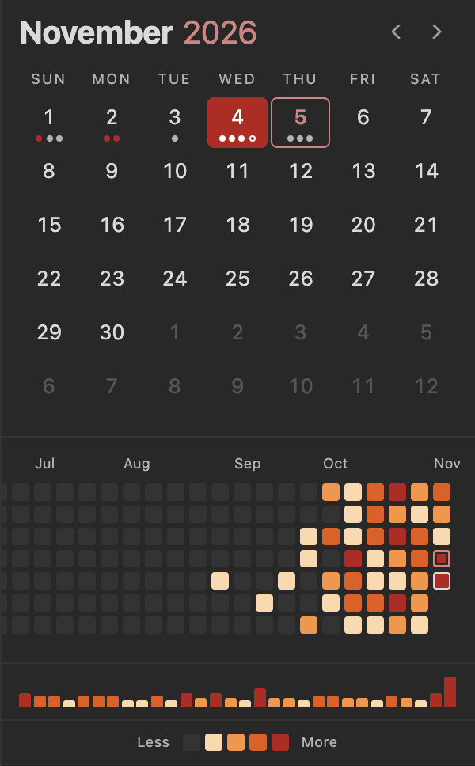
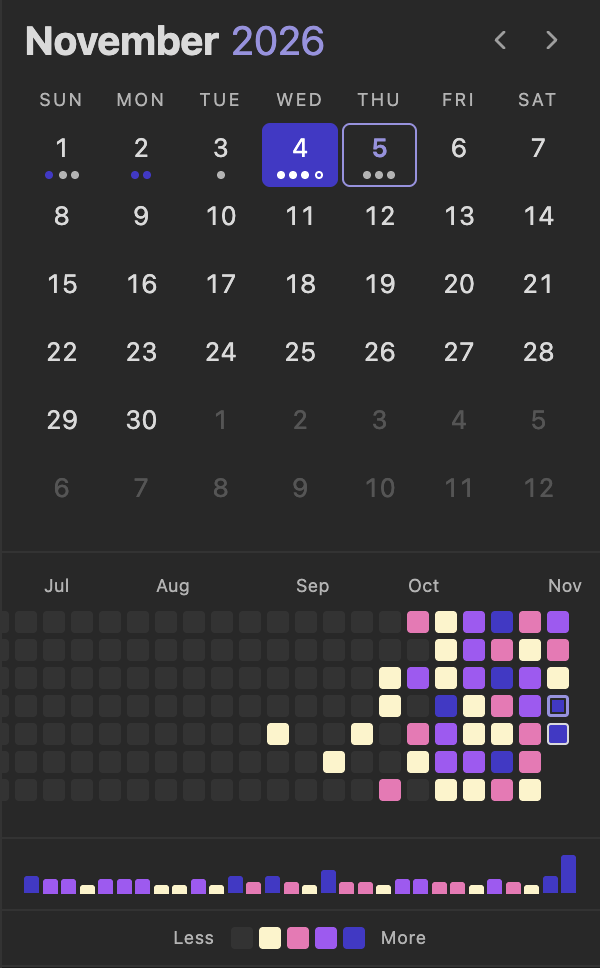

# Vault Pulse

A month calendar and a GitHub-style activity heatmap for Obsidian. The calendar puts a dot on each day for every note created or modified that day. The heatmap shows a year of writing cadence in a 53×7 grid. Click a day in either and the panel below lists its notes.

| Light theme | Dark theme |
|:-----:|:-----:|
|  |  |

_The pane with the Auto palette, which follows your theme's accent. In the calendar, accent dots are notes created that day and grey dots notes last modified that day; the ringed day is today and the filled day is selected. Below, the selected day's notes in Created and Modified groups._

| Green | Heat | Sunset |
|:-----:|:----:|:------:|
|  |  |  |
|  |  |  |

_Three of the built-in palettes, in light and dark themes; each colors the calendar and the heatmap. Auto (theme accent) and Custom (any hex) round out the five options._

## Features

- **Sidebar pane** — lives in the right sidebar, collapses like any other panel.
- **Month calendar** — one dot per note created that day and one per note last modified that day, up to three of each. The created date comes from `created:` frontmatter, so a note edited later stays on the day it was made. It's a viewer: clicking a day never creates a note.
- **One selection, both views** — pick a day in the calendar or the heatmap and both show it: the calendar turns to that month, and the heatmap pages back if the day is off its grid.
- **Configurable window** — 90 / 180 / 365 day heatmap; today anchored bottom-right, today's cell always outlined.
- **Quantile-based colors** — buckets adapt to your vault size; no hardcoded thresholds.
- **Five color palettes** — Auto (theme accent), Green (GitHub-style), **Heat** (orange → red), **Sunset** (gold → indigo), or Custom hex.
- **Recent-30 sparkline** — compact bar chart above the legend showing the last 30 days, independent of how far you've scrolled the main grid.
- **Detail panel** — click any day and the panel below lists its notes in two groups, Created and Modified, each clickable (⌘/Ctrl-click for a new tab), each ⌘-hover previewable.
- **Folder / tag filters** — exclude noisy folders (e.g. `Archive`) or restrict to files carrying specific tags.
- **Streak milestones** — lucide 🔥 flame icons at 7 / 30 / 100 days, plus a 🏆 trophy at the 1-year mark. Click the trophy to see the year-1 date.
- **Lifetime best** — remembers your longest-ever streak so you can chase it after a break; flashes gold when you tie or beat it.
- **Visibility toggles** — show the calendar, the heatmap or both, and turn the sparkline and streak counter on or off independently.
- **Style Settings support** — exposes the calendar dot, flame and trophy colors as editable variables when the [Style Settings](https://github.com/mgmeyers/obsidian-style-settings) plugin is installed.
- **Localized** — all user-facing strings route through `src/i18n/` with English shipping today and community-contributed locales welcome.
- **Jump to today** — command palette entry, plus a "Today →" button in the detail header when you've scrolled away.
- **Keyboard navigation** — Tab into the calendar, then ←/→ = ±day, ↑/↓ = ±week, Enter selects; Tab into the heatmap, then ←/→ = ±week, ↑/↓ = ±day. The detail panel updates as you move.
- **Pop-out windows** — the pane works when dragged into its own window.
- **Apple-style scroll bounce** — mass-spring-damper physics tuned to SwiftUI's default feel (`response=0.55s`, `dampingFraction=0.825`).
- **Theme-aware** — colors follow your Obsidian theme and re-render on theme switch.
- **Auto-updates** — edits, creates, deletes, and renames re-render within ~200ms (debounced).
- **Mobile-compatible** — no Node / Electron APIs; `isDesktopOnly: false`.
- **Reduced-motion friendly** — every animation and the scroll bounce disable when the OS has Reduce Motion enabled.

## Install

### From the community plugin store

Install from **Settings → Community plugins → Browse → search "Vault Pulse"**. Vault Pulse 1.0 needs Obsidian 1.13 or later; older Obsidian versions are offered 0.3.4.

### Manual install

1. Download `main.js`, `manifest.json`, and `styles.css` from the latest [release](https://github.com/stefmf/vault-pulse/releases).
2. Copy them into `<YourVault>/.obsidian/plugins/vault-pulse/` (create the folder if it doesn't exist).
3. In Obsidian: **Settings → Community plugins**, enable **Vault Pulse**.

### Build from source

```bash
git clone https://github.com/stefmf/vault-pulse.git
cd vault-pulse
npm install
npm run build
```

Copy `main.js`, `manifest.json`, and `styles.css` into `<YourVault>/.obsidian/plugins/vault-pulse/`, or use `npm run seed` (see Development) which sets up a throwaway vault with the plugin pre-installed.

## Usage

Open the pane via the **grid** ribbon icon (left sidebar) or the command palette entry **Vault Pulse: Open calendar and heatmap**. The calendar sits at the top, the heatmap under it, and the day's notes at the bottom.

- **Click** a calendar day → it's selected in both views and its notes are listed. The calendar's arrows change only the month shown.
- **Hover** a heatmap cell → tooltip: `Mon DD · N files`.
- **Click** a heatmap cell → the calendar turns to that month and the detail panel lists the day's notes; click a row to open it, ⌘/Ctrl-click for a new tab.
- **⌘-hover** (macOS) / **Ctrl-hover** (Windows/Linux) a file row → Obsidian's native note preview popover.
- **Tab** into the grid, then **arrow keys** to move: ←/→ = prev/next week, ↑/↓ = prev/next day.
- **Esc** or **click outside** the pane closes nothing — the detail panel is always visible.
- Run **Vault Pulse: Jump to today** (⌘P) or click the **Today →** button in the detail header to scroll back and re-select today.

## Settings

| Setting | Options | Notes |
|---------|---------|-------|
| **Activity source** | Combined / Modified / Created | Default: Combined. A file counts for a day if **either** created OR updated matches that day. Applies to the heatmap; the calendar always shows both. |
| **Modified date** | Updated property, then file time / File time only | Default: Updated property, then file time. Which date counts as a note's last change, in both views. Pick file time only if your `updated:` property is a manual review date rather than one a plugin keeps current. |
| **Color palette** | Auto · Green · Heat · Sunset · Custom hex | Auto follows `--interactive-accent`. Named palettes use discrete hex values tuned for both light and dark themes. Colors the calendar too: its today ring, selected day and created dots use the palette's strongest color. |
| **Custom hex color** | Color picker | Only visible when palette is "Custom hex". |
| **Window length** | 90 / 180 / 365 days | Default: 365. Shorter windows narrow the grid but bring recent activity into sharper view. |
| **Week starts on** | Sunday / Monday | Default: Sunday (matches GitHub). |
| **Exclude folders** | Comma-separated path prefixes | e.g. `Archive, _templates`. Prefix matching: `Archive` excludes `Archive/...` but not `My-Archive/...`. Empty = include all. |
| **Include tags** | Comma-separated tag names (leading `#` optional) | e.g. `project, journal`. If set, files must have AT LEAST ONE of these tags. Empty = include all. Reads both frontmatter `tags:` and inline `#tags`. |
| **Show calendar** | On / Off | Default: On. Toggles the month calendar. |
| **Show heatmap** | On / Off | Default: On. Toggles the heatmap with its pager, sparkline and legend. One of the two always stays on. |
| **Show sparkline** | On / Off | Default: On. Toggles the 30-day bar chart above the legend. |
| **Show streak counter** | On / Off | Default: On. Toggles the flame / trophy milestone row in the detail header. |
| **Show mini stats** | On / Off | Default: On. Toggles the week / month / year file counts under the streak row. |
| **Show status bar widget** | On / Off | Default: On. Toggles the streak + today's-files summary in Obsidian's status bar. |

## Streaks

Vault Pulse tracks consecutive active days across your whole vault (not capped to the window) and rewards consistency with a small milestone ladder:

| Day | Milestone |
|-----|-----------|
| 7 | 🔥 first flame |
| 30 | 🔥🔥 second flame |
| 100 | 🔥🔥🔥 third flame |
| 365 | 🔥🔥🔥 🏆 trophy (grand celebration — gold confetti + bigger ripple) |

Additional:

- **Lifetime best** — `· best N` renders next to the current streak and persists across broken streaks. Flashes gold on ties / new records.
- **Window pager** — `◀ [range] ▶` above the heatmap steps backward through history one window at a time. Disabled when no older activity remains or when the grid ends on today. Reusing the existing **Today →** button returns you home in one click and resets the offset.
- **Status bar widget** — `🔥 N · [file] M` in Obsidian's status bar shows the current streak (once it's ≥ 7 days) and today's file count. Clicking it opens the pane.
- **Mini stats** — under the streak row, `N WEEK · M MONTH · K YEAR` gives at-a-glance velocity (last 7 days / calendar month / calendar year).
- **Tier crossings** fire a short ripple + CSS confetti burst; the year-trophy crossover uses a gold-weighted palette with extra pieces and a larger ripple. Everything respects `prefers-reduced-motion`.

### Frontmatter dates

Vault Pulse reads `created` and `updated` from each note's frontmatter when present. Supported formats: ISO 8601 (`2026-04-13`, `2026-04-13T12:34:56`), SQL (`2026-04-13 12:34:56`), JS Date objects, and Unix millisecond epochs. A date-only value counts on that day in your own time zone.

- **Created:** `created:`, else the file's creation time (`ctime`). Prefer the frontmatter: tools that save by rewriting a file reset its creation time on every edit.
- **Modified:** with **Modified date** on its default, `updated:`, else the file's modification time (`mtime`). With **File time only**, always `mtime`. Only the last modification is known, so a note shows on the day it was last changed. On a device that gets your vault through sync, `mtime` is when the sync wrote the file.
- A note created and last modified on the same day counts once, as created.

## Permissions & data access

Vault Pulse runs entirely on your device. It does not make network requests, send telemetry, or transmit your notes anywhere.

To render the calendar, heatmap and detail panel, the plugin reads:

- **All markdown file paths** in your vault via `app.vault.getMarkdownFiles()` — required to discover which days had writing activity.
- **Each note's frontmatter** (`created`, `updated`, and `tags` / `tag`) via Obsidian's metadata cache — used for accurate date detection and the optional **Include tags** filter.
- **Each note's inline tags** via the metadata cache — also used for the tag filter.
- **Filesystem `ctime` / `mtime`** as fallbacks when frontmatter dates are absent, and `mtime` alone when **Modified date** is set to file time only.

The plugin does **not** read note bodies. Files inside folders listed under **Exclude folders** are skipped entirely.

All state — settings, lifetime-best streak, recent windows — is stored locally in `<vault>/.obsidian/plugins/vault-pulse/data.json`.

## How the colors work

Activity levels use quantile bucketing over the **non-zero days** in the 365-day window:

| Level | Condition |
|-------|-----------|
| 0 | count = 0 (theme border color) |
| 1 | `count ≤ p25` |
| 2 | `p25 < count ≤ p50` |
| 3 | `p50 < count ≤ p75` |
| 4 | `count > p75` |

This adapts automatically: a light vault with ~1 note/day and a heavy vault with dozens/day both end up with meaningful bucketing. For the Auto and Custom palettes the colors are computed as alpha-blends of your base color, so empty days show through the theme background. For Green, Heat, and Sunset, the four levels are pre-tuned discrete hex values.

## Contributing

- **Local development, test vault setup, seeding flags, lint/test/build commands** — see [`tests/README.md`](tests/README.md).
- **Module responsibilities, file-level conventions** — see [`AGENTS.md`](AGENTS.md).
- **Translations** — copy [`src/i18n/en.json`](src/i18n/en.json) to `<lang>.json`, translate values (don't rename keys or change `{placeholder}` tokens), register in [`src/i18n/index.ts`](src/i18n/index.ts), open a PR. Obsidian's `moment.locale()` auto-picks the right bundle.

## Credits

The calendar's look follows Liam Cain's [Calendar](https://github.com/liamcain/obsidian-calendar-plugin) plugin. Vault Pulse uses none of its code.

## License

[MIT](LICENSE) © 2026 Stefmf
